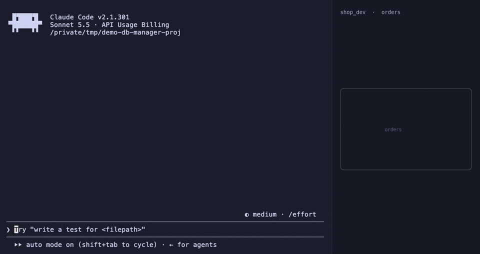

# db-manager

[](https://github.com/jeanpfs/db-manager/actions/workflows/ci.yml)
[](./LICENSE)
[](https://github.com/jeanpfs/db-manager/releases)

A [Claude Code](https://docs.claude.com/en/docs/claude-code) skill for safe PostgreSQL access from project `.env` files.

The skill auto-detects `DATABASE_URL` in your project's `.env` files, lets the agent run `psql` against the right environment, and gates destructive operations behind an explicit confirmation protocol.



## Features

- Auto-discovers `.env`, `.env.local`, `.env.development`, `.env.staging`, `.env.production` with `DATABASE_URL` / `DB_URL` / `POSTGRES_URL`
- Per-project session keyed by working directory, stored under `~/.cache/db-manager/` with mode `600`
- Session file holds **only** the path to the `.env` and a label — never the URL itself
- Mandatory schema inspection (`\d`) before generating SQL
- Strict confirmation block for any mutation (`INSERT`, `UPDATE`, `DELETE`, `DROP`, `ALTER`, `EXPLAIN ANALYZE`, etc.)
- Extra `CONFIRM PRODUCTION` lock when the label contains `prod`
- Audit log of every confirmed destructive operation

## Requirements

- [Claude Code](https://docs.claude.com/en/docs/claude-code) (skills are loaded from `~/.claude/skills/`)
- `bash` ≥ 4
- `psql` and `pg_dump` (PostgreSQL client tools)
- `find`, `grep`, `cut`, `head`, `printf`, `mktemp`, `install`, `chmod`
- `sha256sum` (Linux) **or** `shasum` (macOS) — the snippets fall back automatically

Tested on macOS 14+ and Ubuntu 22.04+. CI runs on `ubuntu-latest` and `macos-latest`.

## Install

```bash
git clone https://github.com/jeanpfs/db-manager.git
cd db-manager
./install.sh
```

This copies `SKILL.md`, `LICENSE`, `README.md` and `references/` into `~/.claude/skills/db-manager/`. Existing installs are moved to a timestamped backup, never deleted. Symlinked install paths are refused.

## Usage

In Claude Code, ask any database question — for example:

```
show me the tables
run SELECT count(*) from users
which users signed up in the last 24h?
```

The skill will:

1. Look for `.env` files with a database URL.
2. Ask you which environment to use (or pick the only one).
3. Save session metadata under `~/.cache/db-manager/session_<hash>` (mode `600`).
4. Run `\d` on the relevant tables before writing SQL.
5. Run the query.

For mutations, the skill prints a confirmation block including the exact SQL and a `SELECT COUNT(*)` estimate (or an `Impact:` description for DDL), and waits for you to type `CONFIRM` (or `CONFIRM PRODUCTION` for production).

### Switching environments

Re-run the connection step in a fresh conversation; the session file under `~/.cache/db-manager/` is overwritten in place. To forget all sessions:

```bash
rm -rf ~/.cache/db-manager
```

## Threat model

**Protects against:**

- Agent-generated mutations executing without explicit human approval
- Hallucinated column names producing silently wrong queries
- Accidental writes to production when intending to hit dev
- Persisting credentials in long-lived files outside the project

**Does not protect against:**

- A compromised `.env` file in the project (pre-existing risk; same as any local dev)
- Local users on the same machine reading the project's `.env`
- Connection URIs visible in `/proc/<pid>/cmdline` on Linux while `psql` is running. For higher assurance use `~/.pgpass` (mode `600`) and pass host/db/user instead of the full URL
- Tampered `.env` content pointing `psql` at a hostile server — the skill treats the URL as data, not code, but cannot validate the destination

## Files written by the skill

| Path | Mode | Contents |
|------|------|----------|
| `~/.cache/db-manager/session_<hash>` | `600` | Path to the project `.env`, label, source — **no URL** |
| `~/.cache/db-manager/audit_<hash>.log` | `600` | Timestamped log of confirmed destructive operations |
| `docs/schema.sql` (only on explicit request) | repo-default | `pg_dump --schema-only`, no data |

## Troubleshooting

**The skill keeps asking for permission to run common commands.**
Ensure you ran `./install.sh` recently — the `allowed-tools` list grew between releases.

**`psql: command not found`.**
Install PostgreSQL client tools: `brew install libpq` (macOS) or `apt install postgresql-client` (Debian/Ubuntu).

**`shasum: command not found` on Linux.**
The snippets prefer `sha256sum` and only fall back to `shasum`. If both are missing, install `coreutils` (`apt install coreutils`).

**Session points to the wrong `.env`.**
Delete the session file and reconnect:

```bash
rm -f ~/.cache/db-manager/session_*
```

**`No .env files with DATABASE_URL found`.**
The skill searches for `^DATABASE_URL=`, `^DB_URL=`, `^POSTGRES_URL=` (no leading whitespace). Make sure the line starts at column 0 and has the equals sign right after the variable name.

## Security

To report a vulnerability, see [SECURITY.md](./SECURITY.md). Please **do not** open public issues for security reports.

## Contributing

PRs welcome. See [CONTRIBUTING.md](./CONTRIBUTING.md) and [CODE_OF_CONDUCT.md](./CODE_OF_CONDUCT.md).

## Uninstall

```bash
rm -rf ~/.claude/skills/db-manager
rm -rf ~/.cache/db-manager
```

## License

MIT — see [LICENSE](./LICENSE).
